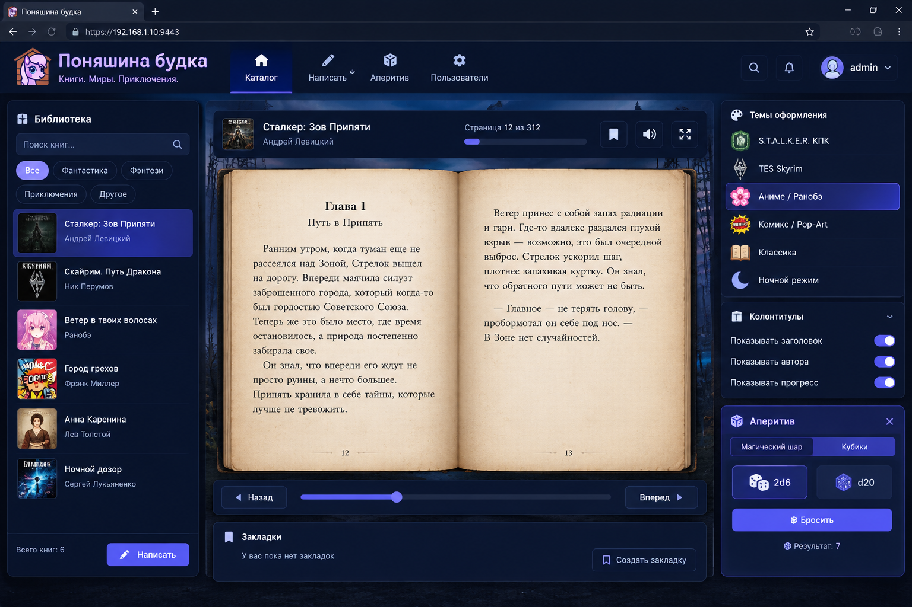

# 📖 Поняшина будка (Ponya Budka)

> **Мемно-котяче-собачий притон & Атмосферная читалка на SQLite**  
> Полноэкранный 3-колоночный Dashboard с темами оформления, надежной базой данных SQLite (WAL-режим), защитой авторизации через bcrypt и Rate Limiting, поддержкой PWA и мини-играми в разделе «Аперитив».

---

## 📸 Скриншоты интерфейса

### Главный Dashboard читалки


*Интерфейс Dashboard включает:*
- **Левая колонка:** Библиотека с мгновенным поиском, фильтрами по жанрам (*Фантастика*, *Фэнтези*, *Приключения*, *Другое*), списком книг и кнопками добавления/удаления.
- **Центральная часть:** Разворот открытой книги с реалистичным перелистыванием, верхней строкой статуса, ползунком прогресса чтения и закладками.
- **Правая колонка:** Селектор тем оформления, переключатели колонтитулов и интерактивный блок «Аперитив» (Шар №8 и кубики d6/d20).

---

## ✨ Возможности и Архитектура

- **3-колоночный интерфейс Dashboard**: Оптимизирован под ПК, планшеты и смартфоны.
- **Атмосферные стили чтения**:
  - ☢️ **S.T.A.L.K.E.R. КПК** (зеленый монохромный терминал, сканлайн-эффект, счетчик радиации).
  - 🐉 **TES Skyrim** (древний нордский пергамент).
  - 🌸 **Аниме / Ранобэ** (розовая палитра, лепестки сакуры).
  - 💥 **Комикс / Pop-Art** (контрастный поп-арт стиль).
  - 📜 **Классика (Сепия)** и 🌙 **Ночной режим**.
- **🎲 Раздел «Аперитив»**:
  - **Магический Шар №8**: анимация предсказаний и мемные реплики на удачу.
  - **Игральные кости (2d6 и d20)**: генератор случайных бросков.
- **🛡️ Безопасность и надежность**:
  - **Хэширование bcrypt (`bcryptjs`)**: пароль администратора генерируется автоматически при первом развертывании и сохраняется в базе `library.db` исключительно в виде криптостойкого хэша.
  - **Защита от подбора паролей (Rate Limiting)**: временная блокировка IP-адреса на 15 минут при 5 неверных попытках входа.
  - **SQLite (WAL mode)** через `better-sqlite3`: надежное хранение без риска повреждения при параллельных запросах.
  - **Автоматический бэкап**: создание копии базы данных перед каждым обновлением в `/var/backups/budka/`.
  - **PWA (Progressive Web App)**: поддержка установки на мобильные устройства и Service Worker кэширование статики.

---

## 🚀 Установка одной строкой (Ubuntu / Debian)

Подключитесь к серверу по SSH и выполните:

```bash
curl -sSL https://raw.githubusercontent.com/nitrous-beer/ponya-budka/main/deploy.sh | sudo bash
```

В конце выполнения скрипт отобразит сгенерированный уникальный пароль администратора.

---

## 🛠 Управление и команды deploy.sh

```bash
# Обновление проекта (с автобэкапом базы данных):
sudo bash deploy.sh

# Удаление службы и веб-сервера (без удаления ваших книг):
sudo bash deploy.sh --uninstall --yes
```

---

## 🛠 Локальный запуск (Разработка)

```bash
git clone https://github.com/nitrous-beer/ponya-budka.git
cd ponya-budka
npm install
npm start
```
Сервер будет доступен по адресу `http://localhost:3000`.

---

## 📂 Структура репозитория

```text
ponya-budka/
├── .github/workflows/
│   └── check.yml            # CI проверка синтаксиса
├── .gitignore               # Исключение локальных баз и логов
├── package.json             # Зависимости Node.js (better-sqlite3, bcryptjs)
├── README.md                # Описание и документация
├── server.js                # Серверный API (SQLite WAL, bcrypt, rate limit)
├── deploy.sh                # Установщик с бэкапом и CLI
├── docs/
│   └── screenshots/
│       └── main-dashboard.png
├── data/
│   └── library.db           # База данных SQLite (генерируется автоматически)
└── public/
    ├── index.html           # Разметка Dashboard
    ├── style.css            # Стили тем и верстка
    ├── app.js               # Клиентская логика читалки
    ├── manifest.json        # PWA-манифест
    └── sw.js                # Service Worker
```

---

## 📄 Лицензия

Распространяется под лицензией MIT.
